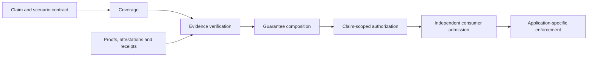

# Verifiable Execution & Claim Authorization

Experimental research and executable verification tools for determining **which
downstream claims a collection of proofs, attestations and execution records can
actually authorize**.

A valid inference proof, authentic judgment and valid receipt can refer to different
inputs, subjects, actions or policies. This project makes those relationships explicit,
checks the evidence for each required relationship, and recomputes authorization at
the consumer boundary.

> **Research status: PARTIAL_CHAIN_VERIFIED.** The integration and escrow experiments
> are reproducible laboratory studies. A complete external provenance-to-execution
> chain has not been established. **Production payments: HOLD.**

Initiated by [Pavlo / pipavlo82](https://github.com/pipavlo82) as
`verifiable-ai-guarantee-composition`, the project now lives under
[Trustless AI](https://github.com/trustless-ai), preserving its history, contributors,
pull requests and evidence. Research policies here are separate from normative ERC
requirements; this repository is not a security certification.

## Project structure

| Component | Purpose and current state |
| --- | --- |
| Research model | Typed guarantees, dependencies, authorities, scenario contracts, counterexamples and prior-art analysis |
| Claim-Aware Verification Engine | Experimental composition, claim-scoped authorization and independently recomputed consumer admission |
| Agent Conformance Harness | Implemented versioned request/observation protocol, caller-selected adapters and pinned recompute-kit grader; finite ERC-8404 and ERC-8004 laboratory profiles |
| ERC-8004 policies and generated tests | Registry pilot, request-time role policies v1/v2 and bounded state-transition generation with physical Solidity mutation controls |
| Specification drift and obligation evidence | Source comparison and evidence-level mapping; neither drift success nor a test PASS grants authorization |
| Application adapters | External ERC-8404 consumer and verdict-gated escrow laboratory experiment |

The conformance harness is a component of the broader research programme. Escrow is
one downstream use case, not the definition of the project.



**Coverage** identifies obligations from an independently supplied scenario contract.
**Verification** checks whether evidence establishes each obligation. **Composition**
determines whether those guarantees jointly authorize the requested claim. Contract
adequacy remains an external assumption: a list of implemented checks does not prove
that every necessary requirement was declared.

Decisions retain `VERIFIED`, `REFUTED` and `UNVERIFIABLE`. Missing evidence refuses
authorization without becoming a refutation. Authorized results identify the scenario,
claim type, recomputed contract digest and verified scope. Admission does not trust a
mutable `authorized=true` flag. Checker independence (O14) applies only when required
by policy; different keys do not prove different real-world controllers.

Read the [engine contract](research/integration/CLAIM_AWARE_ENGINE.md),
[coverage model](research/v4/FORMAL_MODEL.md),
[obligation catalog](research/v4/OBLIGATION_CATALOG.md) and
[trust boundaries](research/integration/TRUST_BOUNDARIES.md).

## Current integrated state

As of **2026-11-20**, PR #14 integrated PR #12/#13 and PR #15 updated the
project documentation. The verified main baseline for this candidate is
[`29155372c6a16f23d1bc2091f2f3671c51e0da4c`](https://github.com/trustless-ai/verifiable-execution-claim-authorization/commit/29155372c6a16f23d1bc2091f2f3671c51e0da4c).
PR #12/#13 must not be merged separately again.

This candidate integrates the [second-backend pilot](research/erc8004-second-backend-integration-v1/README.md):
the same existing 29-case ERC-8004 profile against pinned Solidity and Vyper code,
through the existing harness and grader. Its separate [integration report](research/erc8004-second-backend-integration-v1/REPORT.md)
records the current candidate's executions and preservation checks. The Vyper port
is reference-informed; shared EVM, observer, policy and grader are not independent
implementations of those verification layers. Historical pilot reports retain
their original local-only status; they do not describe this later integration.

The [integration report](research/pr12-pr13-integration-v1/REPORT.md) records the
executed source candidate, closing report/evidence-only changes, historical
baselines, commands, failures and limits. The
[replay guide](research/pr12-pr13-integration-v1/README.md) selects the versioned
entrypoints for this composed tree. Consult
[GitHub Actions](https://github.com/trustless-ai/verifiable-execution-claim-authorization/actions)
for the exact commit's CI; prior-head success is not a new merge-commit execution.

Historical reports describe their own dates, commits and publication constraints.
References there to drafts, unmerged dependencies or prohibited publication are
historical, not current repository status. Original results and failed runs remain
preserved. Merging research does not establish independent academic approval or
production readiness.

## Implemented profiles and evidence

These are separate finite populations. Repeated and optimized runs do not create
new cases or mutations. Counts below describe the preserved integration replay,
not a new execution caused by reading this page.

| Profile or layer | Recorded scope | Evidence boundary |
| --- | --- | --- |
| [ERC-8404 harness](conformance/agent-harness-v0/README.md) | 18 cases; 12 external-consumer mutants KILLED | Executes the pinned Core; conformance PASS is not payment permission |
| [ERC-8004 registry pilot](conformance/erc8004-pilot-v0/README.md) | 29 cases; 17 mutants KILLED | Local EVM observations of pinned contracts, not authenticated public-chain execution |
| [Solidity/Vyper comparison](research/erc8004-second-backend-integration-v1/README.md) | Same 29 cases per backend; 6 separate Vyper mutants; normal/repeat/-O and source controls | Finite same-profile agreement; reference-informed Vyper port; shared observer/EVM/policy/grader, no clean-room or human-review claim |
| [Role policy v1](research/erc8004-role-policy-v1/README.md) | 26 cases; 7 mutants KILLED | Request-time owner/operator/token-approval separation under an external research policy |
| [Role policy v2](research/erc8004-role-policy-v2/README.md) | 50 cases; 5 mutants KILLED | Also binds request-block agentWallet calls; different addresses do not prove independent controllers |
| [Supplemental harness review](conformance/agent-harness-review-v0/README.md) | 5 cases; 4 isolated mutants KILLED | The historical comparison remains separately 1 KILLED / 4 SURVIVED |
| [Bounded ERC-8004 generation](research/erc8004-property-fuzz-v0/README.md) | 300 cases, seeds 8004/8299/8274, 100 each; 6 Solidity mutants KILLED | The original 29-case matrix misses these six; generated witnesses and restored positive controls distinguish them. Not universal contract correctness |
| [Specification drift and obligation evidence](research/spec-drift-coverage-v0/README.md) | 51 obligations: 39 guard-mapped, 12 executed-only; 32 integrated controls plus 13 transport controls | The 32 are 31 unchanged semantic controls plus 1 versioned preservation control. Reconciles historical execution evidence; does not newly execute the EVM |

The original 32-control PR #13 baseline and the integrated population are recorded
separately. Missing runs, unrelated mutations and unsupported independence claims
cannot raise evidence levels. Network errors are not unchanged-source evidence.
Source drift requests review; it does not rewrite pins or historical verdicts.

## Earlier integration and escrow results

These are **two separate finite experiments** with different baselines and
denominators. Counts do not estimate deployment exploit rates or universal coverage.

| Experiment | Scenarios | Applied mutations | Unsupported downstream authorizations |
| --- | --- | --- | --- |
| Claim-aware integration | 61: 2 positives, 59 negative/unsupported | 22 KILLED / 0 SURVIVED / 0 CRASHED | Component-only: 51/59; declared checks: 13/59; scenario-complete composition: 0/59; independently recomputed admission: 0/59 |
| Verdict-gated escrow | 31/31 expected: 1 positive, 28 authorization-negative, 2 token-execution controls | 22 KILLED / 0 SURVIVED / 0 CRASHED; 6 absent on-chain guards separately NOT_APPLIED | Signed verdict only: 24/28; claim-aware issuance: 2/28; issuance plus existing on-chain enforcement: 2/28 |

The two remaining escrow cases concern **expiration and revocation after signing**.
An earlier admission is not perpetual execution-time authorization. These are not
surviving mutants. Missing broader research-policy checks are not automatically
violations of the upstream contract's documented, narrower guarantees.

Replay suites cover normal/repeated/Python `-O` runs, native proof verification,
cryptographic cross-checks, source-copy mutations and deterministic semantic outputs.
Crashes are not kills; repeated regression runs do not create additional mutations.

- **Integration:** [results](research/integration/EXPERIMENT_RESULTS.md),
  [mutations](research/integration/MUTATION_REPORT.md),
  [machine-readable evidence](evidence/integration/validation/report.json).
- **Escrow:** [technical report](research/escrow-v0/REPORT.md),
  [results and gas-measurement scope](research/escrow-v0/EXPERIMENT_RESULTS.md),
  [mutations](research/escrow-v0/MUTATION_REPORT.md), [evidence](evidence/escrow-v0/).
- **ERC-8404:** [compatibility](research/erc8404/COMPATIBILITY_MATRIX.md),
  [external profile](research/erc8404/CLAIM_AWARE_PROFILE.md),
  [frozen Core baseline](research/erc8404/CORE_BASELINE.md).

ERC-8404 Core, original conformance vectors and upstream escrow implementation remain
unchanged. Additional authorization rules live in external research consumers.

## Reproduce

Clone the complete Git history: integrity checks need pinned ancestor commits.
The pinned legacy replay environment uses Python **3.12**. The setup checks the
current integration before preparing a PR15 worktree and its original historical
replay worktree. Existing sources, Core, fixtures and dependency pins must remain
identical. Old guards execute unchanged against their own exact baselines.
The following **legacy** replay sections run in `build/base15/build/documentation-replay/`.
The **new Solidity/Vyper campaign runs at the current checkout root**, not in a
historical view. See the [integration contract](research/erc8004-second-backend-integration-v1/README.md).

### Lightweight synthetic baseline

```sh
git clone https://github.com/trustless-ai/verifiable-execution-claim-authorization.git
cd verifiable-execution-claim-authorization
python -B tools/verify_artifacts.py
python -B tools/second_backend_integration/replay.py prepare
cd build/base15/build/documentation-replay
python -B tools/verify_artifacts.py
python -B tools/validate.py
```

This standard-library entry point runs the **v0 synthetic baseline**, including
normal/repeat/optimized tests and mutations. It does not establish cryptographic or
full-chain verification. Results go to `build/validation/`.

### Real-artifact integration

Install Node **22.15.0**, Bun **1.3.14** and Rust **1.97.1**, then run:

```sh
rustup override set 1.97.1
python -B tools/v3/prepare.py --online
python -B tools/integration/validate.py
python -B tools/verify_artifacts.py
```

Preparation fetches pinned dependencies and builds the native verifier; it does not
generate replacement evidence. Commands, exit codes and replay logs go to
`build/integration/validation/`. See the
[review checklist](research/integration/INDEPENDENT_REVIEW_CHECKLIST.md) and
[source lock](fixtures/integration/source-lock.json).

### Current harness, ERC-8004 generation and drift replay

Inside the replay worktree prepared above, use Python **3.12**, Node **22.15.0**
and full Git history. Prepare the pinned
grader, local EVM and laboratory signature dependencies:

```sh
python -B tools/agent_harness.py prepare
python -B tools/erc8004/prepare.py
python -B research/formal-v1/prepare_crypto.py
npm ci --ignore-scripts --no-audit --no-fund --prefix build/formal-v1/crypto
python -B tools/pr12_pr13_integration/preservation.py
python -B tools/pr12_pr13_integration/fuzz_validate.py --out build/readme-replay-fuzz
python -B tools/pr12_pr13_integration/spec_validate.py --out build/readme-replay-spec
python -B tools/pr12_pr13_integration/runtime_binding.py --out build/readme-core-binding
python -B tools/pr12_pr13_integration/controls.py --out build/readme-preservation-controls
python -B tools/verify_artifacts.py
```

Run campaigns sequentially and choose unused output directories. Preparation fetches
pinned dependencies; subsequent deterministic replay uses the prepared local caches.
The fuzz validator executes normal/repeat/optimized cases, six physical Solidity
mutations in normal and optimized modes, restoration checks and legacy regressions.
The spec validator compares offline coverage and captured drift outputs across modes.
These integration wrappers select the explicit preservation contract; original
PR #12/#13 validators remain replay instructions for their own historical baselines.
Use the profile links above for role-policy and supplemental-review commands.

Run live upstream observation separately from deterministic replay:

```sh
python -B tools/pr12_pr13_integration/spec_cli.py drift --live --out build/readme-live-drift
```

This public-source HTTP observation preserves response bytes and comparison status.
A successful comparison is not a conformance or authorization verdict. No live
chain, funds or provider credentials are required.

### Local escrow

After integration preparation, install Foundry **1.7.1**; the harness uses solc
**0.8.26**. In a fresh checkout, reproduce the locked forge-std bytes as the
[CI workflow](.github/workflows/verdict-escrow.yml) does:

```sh
git -c core.autocrlf=true clone --no-checkout https://github.com/foundry-rs/forge-std.git build/escrow/forge-std-source
git -C build/escrow/forge-std-source -c core.autocrlf=true checkout --detach b013eff2ac4fce26f34d789e6f5c49021c5ee817
python -B tools/escrow_prepare.py --forge-std-cache build/escrow/forge-std-source
python -B -X utf8 tools/escrow_ci.py
python -B tools/verify_artifacts.py
```

The dependency checkout setting reproduces its locked representation; repository
technical text uses LF. This suite executes local EVM/mock-token tests, authorization
mutations, integrity controls and semantic determinism checks. It does not broadcast
transactions or require production keys or real funds. Logs go to `build/escrow/ci/`.

### Solidity and Vyper: current candidate

From the **current checkout root**, on Windows x64 with Python **3.12.10** and
Node **22.15.0**:

```powershell
python -B tools/verify_artifacts.py
python -B tools/second_backend_integration/replay.py check
python -B -m unittest discover -s tests/second_backend_integration -v
python -B tools/second_backend_integration/ci.py
```

The campaign prepares byte-pinned dependencies, executes both real backends in
normal/repeat/-O modes, runs six Vyper mutations with restoration, compares exact
semantic outputs and checks source/transport failures. Results are written under
`build/second-backend-integration/campaign/`. These six Vyper mutants are separate
from the older six Solidity fuzz mutants.

Do not regenerate old manifests to conceal mismatches. The exact
[PR15 README snapshot](research/history/README-29155372.md), earlier snapshots,
all old guards, Core, pilot evidence and source locks remain unchanged. The new
[versioned transition](research/erc8004-second-backend-integration-v1/README.md)
enumerates permitted README/workflow changes and exact additions. CI records
current and historical execution identities separately. After replay, run
`python -B tools/second_backend_integration/replay.py check` from the current root.

## Evidence boundaries and next work

The demonstrated chain is **LABORATORY_VERIFIED / PARTIAL_CHAIN_VERIFIED**; the escrow
adapter is **PARTIALLY_COMPATIBLE** with the existing contract.

- Native zkIE verification establishes its pinned statement, not original input
  admission, model authorization or arbitrary task completion.
- Authentic signatures identify signers, not factual judgment correctness or
  independent real-world controllers.
- Coverage assumes adequate scenario contracts and authority policies.
- A receipt or matching digest does not independently establish external execution,
  admission of original bytes or successful real-world payment.
- Escrow does not make the external adapter mandatory or enforce the required
  expiration/revocation policy at execution time. Production signing-service
  compatibility and authenticated payer/state inputs remain unestablished.

The bounded harness and the first same-profile Solidity/Vyper comparison are
implemented. Next work is external replay/review, then a separately versioned
profile for a specific uncovered semantic difference or authenticated external
binding. The current 29 cases do not establish equivalence for every input or
independence of the shared observer, policy and grader. Scientific novelty and end-to-end external success
are not claimed. Read the
[integration limitations](research/integration/LIMITATIONS.md),
[escrow limitations](research/escrow-v0/LIMITATIONS.md) and
[open proof obligations](research/OPEN_PROOF_OBLIGATIONS.md).

## Research history and contribution

| Stage | Preserved contribution |
| --- | --- |
| [v0-v1](research/PAPER_OUTLINE.md) | Synthetic composition and typed obligations. V0 was explicitly reconstructed because the original ZIP was unavailable; that missing archive was never verified. |
| [v2](research/V2_REAL_ARTIFACT_REPORT.md) | Laboratory signatures and native proof artifacts. Original mutations: 18 KILLED / 2 SURVIVED; 1 historical-execution target separately UNVERIFIABLE and unexecuted; the [separate audit](research/V2_SURVIVOR_AUDIT.md) reports 2 isolated kills without rewriting history. |
| [v3](research/V3_REAL_CHAIN_REPORT.md) | Published artifacts, dependencies and explicit missing real-chain links. |
| [v4](research/v4/RESULTS.md) | Scenario-relative coverage independent of the verifier's own check inventory. |
| [v4.1](research/v4_1/README.md) | Scenario-dependent O14 and authorization-scope binding. |
| [ERC-8404 consumer](research/erc8404/EXPERIMENT_RESULTS.md) | External profile. Original 16/1 mutation report and later [fallback isolation](research/integration/MUTATION_REPORT.md) remain distinct. |
| [Integration](research/integration/EXPERIMENT_RESULTS.md) | Combined guarantees and independently recomputed admission. |
| [Escrow](research/escrow-v0/REPORT.md) | Signed-verdict consumption and local enforcement under explicit limits. |
| [Harness and ERC-8004](conformance/erc8004-pilot-v0/README.md) | Reused adapter protocol, local registry execution and separately versioned role policies. |
| [PR #12/#13 integration](research/pr12-pr13-integration-v1/REPORT.md) | Bounded generation, evidence-level mapping and source drift; explicit preservation transition without Core changes. |

For academic context, read the [paper draft](research/ACADEMIC_PAPER_DRAFT.md),
[integration addendum](research/integration/ACADEMIC_PAPER_DRAFT.md) and
[prior-art analysis](research/PRIOR_ART_ANALYSIS.md). Candidate propositions and
observations are not presented as proven general theorems.

Independent review and adapters are welcome. Reports should identify exact commits,
scenario contracts, expected scope, commands and raw outcomes. Separate normative
requirements from research policies; preserve negative witnesses and historical evidence.

Original project code is [MIT licensed](LICENSE). Vendored material and fetched
dependencies retain their upstream licenses and attribution.
